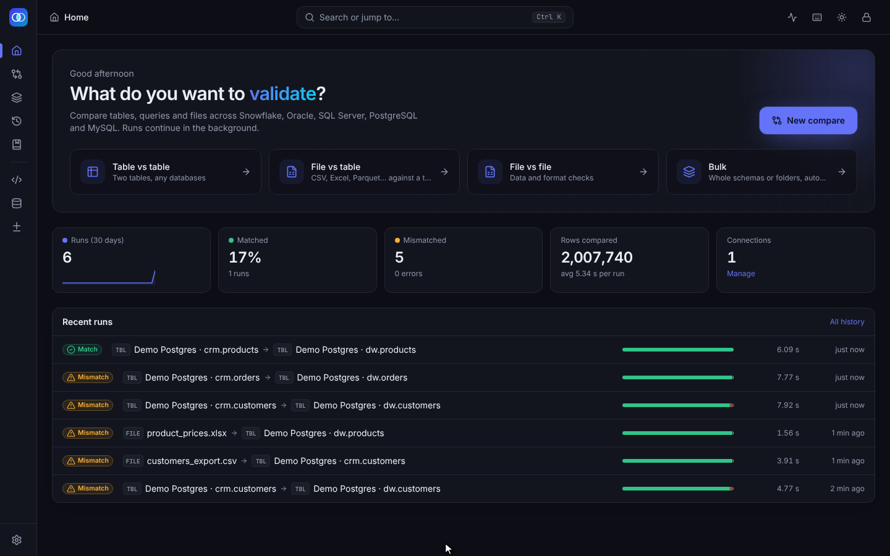
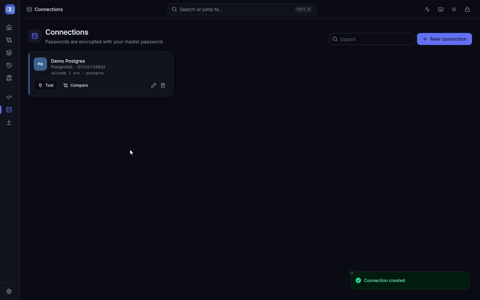
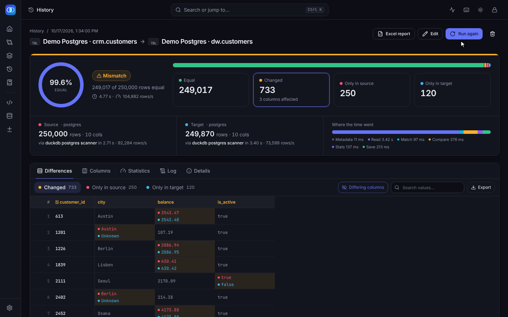
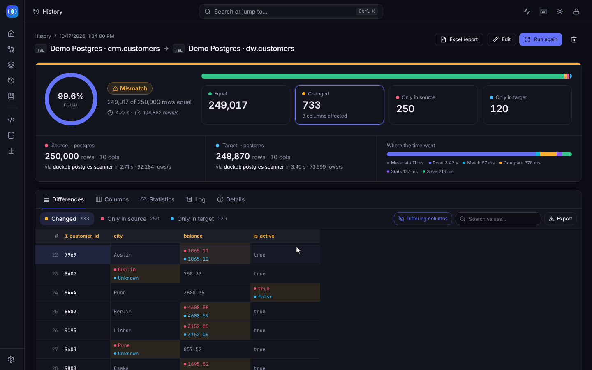
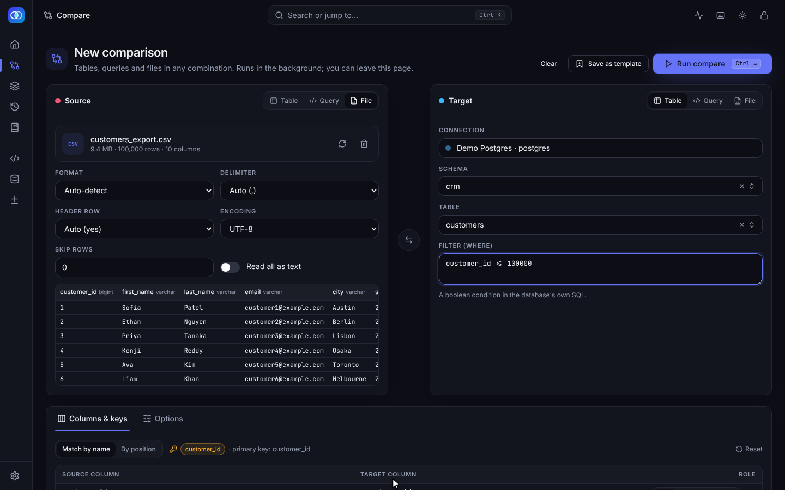
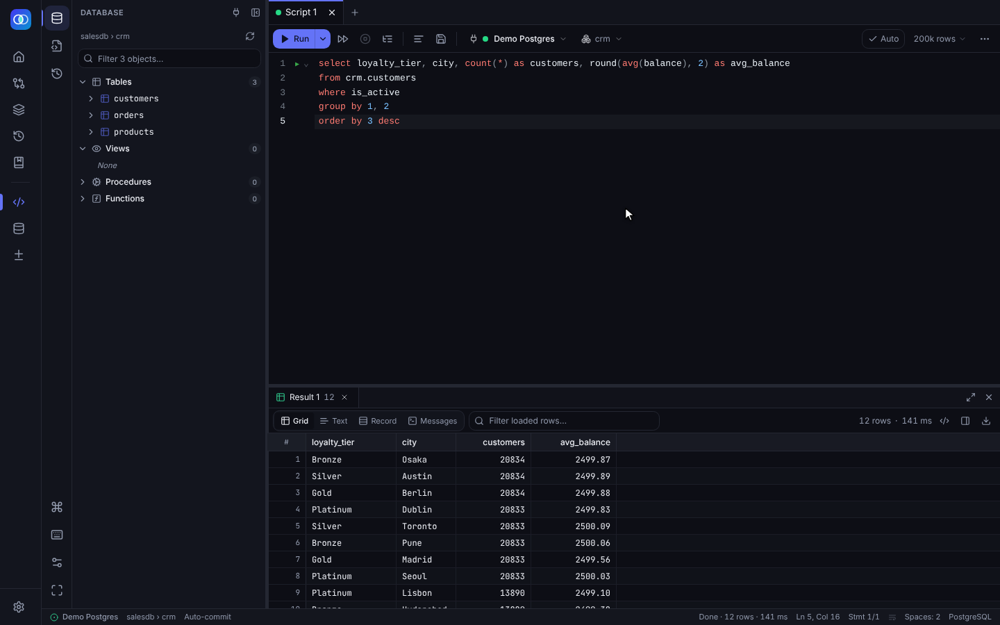
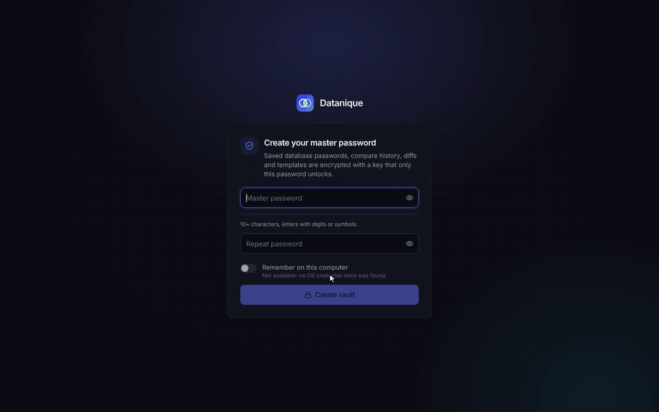

# Datanique

[](https://github.com/nallavenkatnvrr/DataNique/actions/workflows/ci.yml)
[](https://github.com/nallavenkatnvrr/DataNique/releases/latest)
[](https://github.com/nallavenkatnvrr/DataNique/pkgs/container/datanique)
[](LICENSE)

Datanique is a data validation tool I built for comparing data between databases and files. You point it at two sides (a table, a SQL query or a file), it reads both, lines the rows up by key and tells you what matches, what changed and what is missing on either side. It also has a SQL IDE for day to day querying.

Databases: Snowflake, Oracle, SQL Server, PostgreSQL and MySQL. Cross-database compares work too, for example Oracle against Snowflake.



## Get Datanique

| | How |
|---|---|
| **Windows, nothing to install** | Build `Datanique.exe` once with `desktop_py\build-exe.bat`, then copy the zip it makes to anyone. They unzip it and run `Datanique.exe`: no Python, no admin rights, and every Windows user gets their own data. See [Portable app](#portable-app). |
| **Windows with Python** | Download `datanique-<version>-app.zip` from the [latest release](https://github.com/nallavenkatnvrr/DataNique/releases/latest), unzip it and run `start-app.bat`. You need Python 3.10 to 3.14. |
| **Docker** | `docker run -d --name datanique -p 127.0.0.1:8000:8000 -v datanique-data:/data ghcr.io/nallavenkatnvrr/datanique:latest` then open http://localhost:8000 |
| **From source** | `git clone https://github.com/nallavenkatnvrr/DataNique.git` and follow [Getting started](#getting-started-windows). |

## See it in action

Comparing a CRM customer table with its warehouse copy (250,000 rows each):



| Result | Differences |
|---|---|
|  |  |

| CSV file against a table | SQL IDE |
|---|---|
|  |  |

The [user guide](docs/USER-GUIDE.md) walks through every screen step by step: first launch, connections, comparing tables and files, bulk runs, history, templates and the SQL IDE. The data in the screenshots is made up.

## What it does

### Compare

- Table vs table, query vs table, file vs table or file vs file, in any combination.
- Files: CSV, TSV, PSV, TXT, DAT (also .gz, .zst and .zip), Excel (.xlsx, .xlsm, .xlsb, .xls, .ods), Parquet (single file or a folder), JSON and NDJSON, Avro, ORC, Arrow/Feather and fixed width. You can upload a file or read it in place from a path.
- Both sides are read at the same time into DuckDB and compared with a single hash join.
- Readers per database, fastest first. If one fails the next one is tried, and the run log shows which one was used:
  - PostgreSQL: DuckDB scanner, ADBC, cursor
  - MySQL: DuckDB scanner, ADBC, ConnectorX, cursor
  - SQL Server: ADBC, Arrow ODBC, ConnectorX, cursor
  - Snowflake: ADBC (password logins), connector Arrow batches, cursor
  - Oracle: python-oracledb Arrow batches, ConnectorX, cursor
- Values are compared by type, not by text. 12.50 equals 12.5, '007' equals 7, a DATE equals the same TIMESTAMP at midnight, time zones are compared in UTC, doubles to 15 significant digits, and true, 1 and Y are the same. Trimming, ignore case, NULL equals empty, numeric tolerance and timestamp precision are options.
- Keys can be picked by name or position, taken from the primary key, or left out. Without keys the whole row is compared as a multiset. Duplicate keys are paired up instead of multiplied.
- Two big tables on the same connection can be compared inside the database, so only the differing rows come back. This is picked automatically above 20 million rows (`DV_PUSHDOWN_MIN_ROWS`).
- Every difference is saved (up to 5 million rows per kind). You can browse, search and filter them by column, and export to Excel, CSV, Parquet or JSON. There is also an Excel report with the changed cells highlighted.
- When both sides are text files you also get format checks: line endings, BOM, trailing spaces and checksums.
- Bulk mode pairs whole schemas or folders by name and runs them in the background with a concurrency limit.
- Runs keep going if you leave the page. The live view shows rows read, progress and the log, and you can cancel.

### SQL IDE

- CodeMirror 6 editor with highlighting per dialect, completion for tables, columns and keywords, snippets, multi-cursor, find and replace, formatting (Ctrl+Shift+F) and folding.
- Ctrl+Enter runs the statement under the cursor and Alt+X runs the whole script. The splitter understands strings, comments, `$$` bodies, `BEGIN ... END` blocks, Oracle `/`, SQL Server `GO` and MySQL `DELIMITER`.
- Errors are underlined at the line the database reports.
- Results grid with keyboard navigation, range selection, totals for the selection, copy as TSV, CSV, JSON, Markdown, INSERT or IN list, filters, and Text and Record views.
- Explain plan, row counts, parameters (`:name`, `${var}`), auto-commit or manual commit per tab, and a red status bar with a confirmation step for production connections.
- Script tabs, a script library per connection, a database explorer with DDL and INSERT generators, query history and a side-by-side diff of two result sets.

### Security

On first start you set a master password. Saved database passwords, run history, saved differences and templates are encrypted with a key that the password unlocks (scrypt and AES-256-GCM). You get a recovery key once at setup. "Remember on this computer" keeps the key in Windows Credential Manager. While the app is locked the API refuses all requests.

## Getting started (Windows)

The [user guide](docs/USER-GUIDE.md#1-install-and-first-launch) has the same steps with screenshots.

You need Python 3.10 to 3.14 (tested on 3.12 and 3.14) and Node.js 20 or newer.

Easiest way:

```
start-app.bat
```

It creates the Python virtual environment, installs the packages and opens the desktop window. The window shows the built frontend, so build it once first:

```
cd frontend
npm install
npm run build
```

For development, run the backend and the frontend separately:

```powershell
# backend
cd backend
python -m venv .venv
.\.venv\Scripts\Activate.ps1
pip install -r requirements.txt
uvicorn app.main:app --reload --port 8000

# frontend, in a second terminal
cd frontend
npm install
npm run dev
```

Then open http://localhost:5173.

On first start you create a master password and get a recovery key:



Settings go in `backend/.env`. See `backend/.env.example` for the list. Everything has a working default.

### Docker

```
docker run -d --name datanique -p 127.0.0.1:8000:8000 \
  -v datanique-data:/data \
  ghcr.io/nallavenkatnvrr/datanique:latest
```

Open http://localhost:8000 and create the master password. Everything Datanique stores (connections, history, saved differences) is in the `datanique-data` volume. Some notes:

- Keep the port on `127.0.0.1`. Datanique is a single-user tool and the API is protected by the master password, not by user accounts.
- To compare files, mount the folder, for example `-v D:\exports:/files:ro`, and use `/files/...` as the path.
- If you open it through another host name, add it with `-e DV_ALLOWED_HOSTS=myhost`.
- For an unattended server you can pass the master password with `-e DV_VAULT_PASSWORD=...`.
- SQL Server: the image has unixODBC but not the Microsoft ODBC driver. Build your own image on top of it with `msodbcsql18` if you compare SQL Server tables.

Build it yourself with `docker build -t datanique .`.

### Portable app

The portable zip holds `Datanique.exe` and an `_internal` folder with Python, the database drivers and the screens. Keep the two together. It runs from any folder, a USB stick or a shared drive.

Each person who runs it gets their own data folder (connections, master password, history, scripts, exports, logs), so one copy on a shared drive can serve a whole team without anyone seeing someone else's connections:

| Where the data goes | When |
|---|---|
| `%APPDATA%\Datanique\backend-data` | Default. Same folder as `start-app.bat`, so moving to the exe keeps your data. |
| `data\<Windows user name>` beside the exe | A file called `portable` (no extension) is in the exe's folder, or you start it with `--portable`. Handy on a USB stick. |
| Any folder you like | `Datanique.exe --data-dir "D:\Datanique data"` or the `DV_DATA_DIR` setting. |

Settings > Storage shows which folder is in use. Only one Datanique runs per data folder; opening it again brings the window to the front. `--browser` opens it in your web browser instead of a window.

Build it on your Windows PC with `desktop_py\build-exe.bat` (Python 3.10 to 3.14, plus Node.js if `frontend\dist` is not built yet). It takes a few minutes, tests the new exe and leaves `Datanique.exe` and a zip in `desktop_py\dist`. More in [desktop_py/README.md](desktop_py/README.md).

### Offline PCs

The PostgreSQL and MySQL scanners and the encryption support in DuckDB are extensions that DuckDB downloads once. On a PC without internet access, copy them into `backend/duckdb_extensions` (see the README in that folder). If they are missing, Datanique still works. It uses the other readers and encrypts the saved differences itself.

### Running on a network

The backend only listens on localhost by default. If you set `DV_BIND_HOST` to another address you also have to set `DV_API_TOKEN`, and clients send it in the `X-API-Token` header. It is a shared secret, not user accounts.

## Project layout

```
backend/
  app/
    engine/        compare engine: readers, file formats, diff, background jobs, saved differences
    security/      master password and encryption
    connectors/    database drivers
    sql_dialects/  SQL that differs per database
    services/      SQL IDE sessions, DDL generation, settings
    routers/       API routes
    db/            SQLite store
  tests/
  duckdb_extensions/
frontend/
  src/
    pages/         Home, Compare, live job, result, Bulk, History, Templates, Connections, SQL IDE, Settings
    components/
    api/
docs/              user guide, screenshots and GIFs
desktop_py/        desktop window (pywebview)
desktop/           Electron shell (optional)
```

## Tests

```powershell
cd backend
pip install -r requirements-dev.txt
python -m pytest
```

The tests don't need a database. To also run the PostgreSQL reader tests, set `DV_TEST_PG=host:port/db/user[/password]`.

Frontend unit tests (Node 22 or newer):

```
cd frontend
npm test
```

## Notes

- Oracle uses `oracledb` in thin mode, so no Instant Client is needed.
- SQL Server needs the Microsoft ODBC Driver for SQL Server on the machine that runs the backend.
- For a quick check on a huge table, set a row limit per side.
- SQL IDE sessions live in memory. Restarting the backend closes them and an open manual transaction is rolled back. Scripts, history and editor settings are kept in the browser.
- If the screens feel slow, for example on a virtual desktop, go to Settings > Visual effects and pick Light.

## License

MIT
